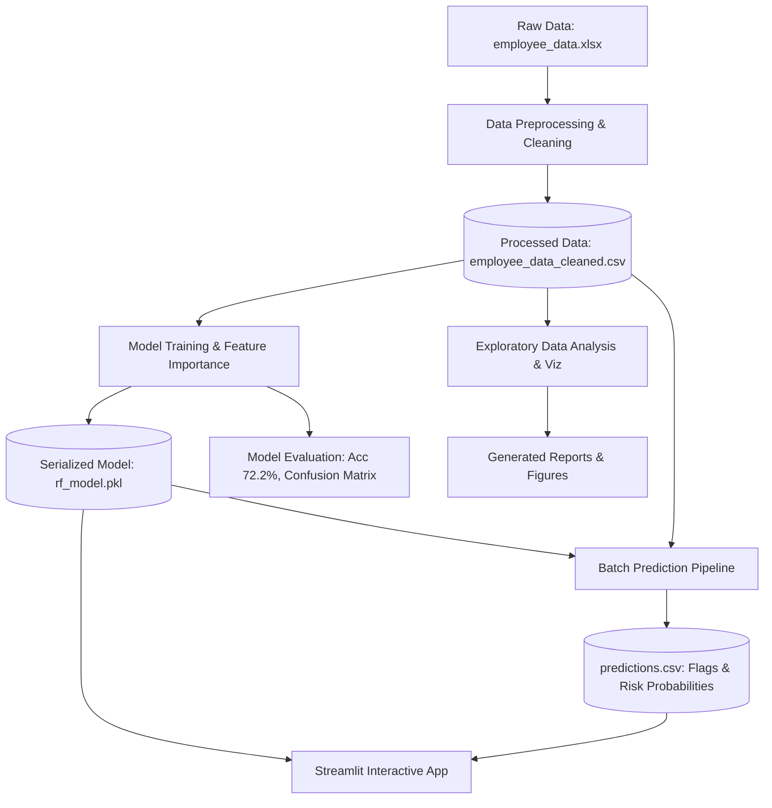
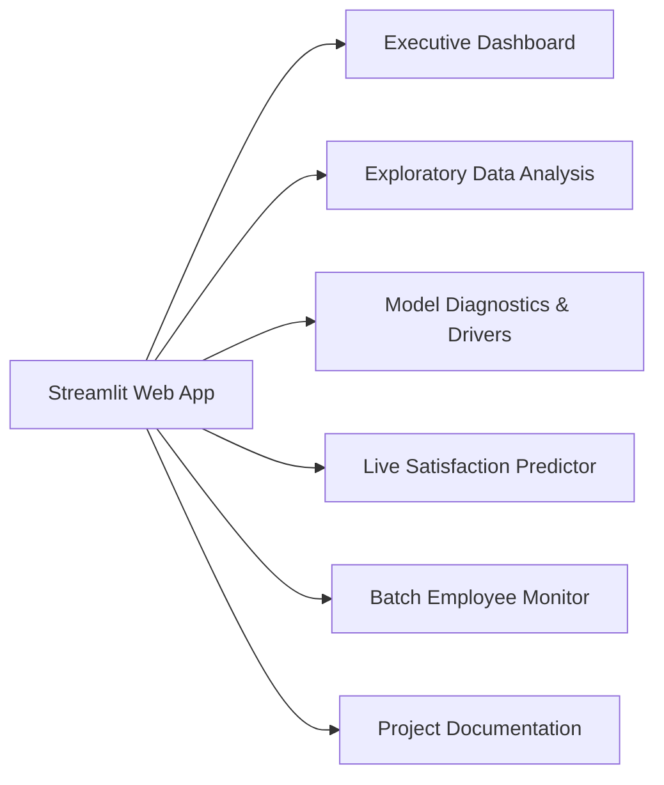

# 🏢 INX Future Inc. — Employee Performance & Satisfaction Analysis

[](https://www.python.org/)
[](https://streamlit.io/)
[](https://scikit-learn.org/)
[](https://iabac.org/certified-data-scientist)
[](LICENSE)
[](validate_notebooks.py)

> **An end-to-end Data Science & Machine Learning system to analyze employee satisfaction and performance drivers, predict workforce attrition risk, and empower HR decision-making with an interactive Streamlit intelligence suite.**

---

## 📑 Table of Contents
1. [Project Overview](#-project-overview)
2. [Problem Statement & Business Context](#-problem-statement--business-context)
3. [IABAC CDS Requirement Mapping](#-iabac-cds-requirement-mapping)
4. [Key Insights & Statistical Findings](#-key-insights--statistical-findings)
5. [System Architecture & Workflow](#-system-architecture--workflow)
6. [Repository Structure](#-repository-structure)
7. [Machine Learning Modeling & Diagnostics](#-machine-learning-modeling--diagnostics)
8. [Interactive Web Dashboard (Streamlit)](#-interactive-web-dashboard-streamlit)
9. [Installation & Setup Guide](#-installation--setup-guide)
10. [Usage & Execution Instructions](#-usage--execution-instructions)
11. [Data Dictionary](#-data-dictionary)
12. [Strategic HR Recommendations](#-strategic-hr-recommendations)
13. [References & Acknowledgments](#-references--acknowledgments)

---

## 🎯 Project Overview

**INX Future Inc.** is experiencing employee engagement variances across departments, impacting productivity, retention, and satisfaction. The goal of this project is to provide HR management with a data-driven diagnostic framework to:
- Identify key organizational drivers of employee performance and job satisfaction.
- Train an explainable machine learning model to proactively detect employees at risk of low satisfaction (`JobSatisfaction ≤ 2`).
- Provide an interactive, full-featured web dashboard for real-time risk assessment, batch workforce monitoring, and data simulation.
- Supply actionable, strategic HR interventions to curb burnout and attrition.

This repository serves as a **Certified Data Scientist (CDS)** project aligned with the official guidelines of the **International Association for Business Analytics Certification (IABAC)**.

---

## 🧠 Problem Statement & Business Context

Employee attrition and burnout cost organizations millions annually in replacement overhead, lost institutional knowledge, and project delays. Traditional HR management relies on lagging indicators (exit interviews). 

This project transforms workforce retention into a **proactive, predictive classification task**:
- **Target Variable**: `LowSatisfaction` (Binary: `1` if `EmpJobSatisfaction ≤ 2` [Low], `0` if `EmpJobSatisfaction ≥ 3` [High/Normal]).
- **Risk Scoring**: Employees with a predicted dissatisfaction probability $> 60\%$ are flagged for high-priority HR retention check-ins.

---

## ✅ IABAC CDS Requirement Mapping

The project satisfies all deliverables mandated by the **IABAC Certified Data Scientist** guidelines:

| Requirement # | Core Deliverable | Implementation Artifacts | Primary Finding / Insight |
| :--- | :--- | :--- | :--- |
| **1. Department-wise Performance** | Analyze satisfaction and performance variance across departments | [`visualize.ipynb`](file:///d:/final%20year%20project/employee-performance-analysis-main/src/visualization/visualize.ipynb)<br>[`eda_summary.md`](file:///d:/final%20year%20project/employee-performance-analysis-main/Project_Summary/Analysis/eda_summary.md)<br>`reports/figures/02_satisfaction_by_department.png` | **Sales** shows the highest proportion of low satisfaction; **R&D** has wider performance variance; **HR** is most consistent. |
| **2. Top Factors Affecting Performance** | Determine top features influencing satisfaction & performance | [`train_model.ipynb`](file:///d:/final%20year%20project/employee-performance-analysis-main/src/models/train_model.ipynb)<br>[`final_insights.md`](file:///d:/final%20year%20project/employee-performance-analysis-main/Project_Summary/Summary/final_insights.md)<br>`reports/figures/06_feature_importance.png` | **Total Work Experience**, **Hourly Rate**, **Age**, **Salary Hike %**, and **OverTime** are the primary drivers. |
| **3. Predictive ML Model** | Train and serialize a supervised classifier for satisfaction risk | [`train_model.ipynb`](file:///d:/final%20year%20project/employee-performance-analysis-main/src/models/train_model.ipynb)<br>[`rf_model.pkl`](file:///d:/final%20year%20project/employee-performance-analysis-main/src/models/rf_model.pkl)<br>[`predict_model.ipynb`](file:///d:/final%20year%20project/employee-performance-analysis-main/src/models/predict_model.ipynb) | **Random Forest Classifier** achieving **72.22% test accuracy** with probability calibration and risk thresholding (`>0.60`). |
| **4. Strategic Recommendations** | Provide actionable HR interventions | [`recommendations.md`](file:///d:/final%20year%20project/employee-performance-analysis-main/Project_Summary/Analysis/recommendations.md)<br>[`app.py`](file:///d:/final%20year%20project/employee-performance-analysis-main/app.py) | Workload balancing in Sales/Overtime groups, workspace environmental audits, role clarity, and risk screening during hiring. |

---

## 🔍 Key Insights & Statistical Findings

1. **OverTime is the Strongest Disengagement Driver**: Employees working OverTime show a significantly higher rate of low satisfaction compared to non-overtime peers.
2. **Departmental Polarization**:
   - **Sales**: Highest proportion of disengaged employees; heavily impacted by quota pressure and travel frequency.
   - **Research & Development**: Balanced overall satisfaction, but wider spread in performance ratings.
   - **Human Resources & Finance**: More stable satisfaction profiles with lower attrition volatility.
3. **Tenure & Experience Dynamics**: Early-career employees (<3 years tenure) and employees experiencing promotion stagnation (3+ years without promotion) display higher propensity toward dissatisfaction.
4. **Work Environment & Involvement**: Direct positive correlation between `EmpEnvironmentSatisfaction`, `EmpJobInvolvement`, and overall `EmpJobSatisfaction`.

---

## 🏗️ System Architecture & Workflow



The pipeline operates across four decoupled stages:
1. **Data Ingestion & Cleaning**: Missing value imputation, datatype verification, and categorical encoding using `LabelEncoder`.
2. **Exploratory Analytics**: Univariate, bivariate, and multivariate distribution analysis saved to `reports/figures/`.
3. **Model Training & Evaluation**: Stratified train/test split (80/20), Random Forest classification, hyperparameter verification, and feature importance generation.
4. **Scoring & Web Deployment**: Batch workforce scoring, high-risk flag allocation, and interactive simulation on Streamlit.

---

## 📁 Repository Structure

```plaintext
employee-performance-analysis/
│
├── .gitignore                      # Git ignore patterns
├── LICENSE                         # MIT License
├── README.md                       # Comprehensive project documentation
├── requirements.txt                # Python package dependencies
├── validate_notebooks.py           # Automated nbformat Jupyter notebook validator
├── main.py                         # Master CLI orchestrator pipeline
├── app.py                          # Streamlit Interactive Web Application
│
├── data/
│   ├── raw/
│   │   └── employee_data.xlsx      # Original raw dataset (86 records, 28 attributes)
│   └── processed/
│       ├── employee_data_cleaned.csv  # Preprocessed & label-encoded dataset
│       └── predictions.csv         # Model predictions with risk scores & flags
│
├── src/
│   ├── Data_Processing/
│   │   ├── data_processing.ipynb            # Notebook: Ingestion, cleaning & encoding
│   │   └── data_exploratory_analysis.ipynb  # Notebook: Statistical exploration & plots
│   ├── models/
│   │   ├── train_model.ipynb       # Notebook: Model training, evaluation & metrics
│   │   ├── predict_model.ipynb     # Notebook: Inference pipeline & batch scoring
│   │   └── rf_model.pkl            # Serialized Random Forest Classifier
│   └── visualization/
│       └── visualize.ipynb         # Notebook: Feature importance & department analysis
│
├── reports/
│   └── figures/                    # High-res publication plots (300 DPI)
│       ├── 01_satisfaction_distribution.png
│       ├── 02_satisfaction_by_department.png
│       ├── 03_satisfaction_by_overtime.png
│       ├── 04_correlation_heatmap.png
│       ├── 05_performance_by_department.png
│       └── 06_feature_importance.png
│
├── Project_Summary/
│   ├── Analysis/
│   │   ├── eda_summary.md          # Detailed exploratory data findings
│   │   └── recommendations.md      # Strategic HR recommendations
│   ├── Requirment/
│   │   └── iabac_mapping.md        # Alignment with IABAC CDS criteria
│   └── Summary/
│       ├── final_insights.md       # High-level summary of model & data drivers
│       ├── project_overview.txt    # Project narrative abstract
│       └── summary.md              # Full executive summary
│
└── references/
    └── references.txt              # Citations, Kaggle source, IABAC links, papers
```

---

## 🤖 Machine Learning Modeling & Diagnostics

### Problem Formulation
- **Algorithm**: `RandomForestClassifier(random_state=42)`
- **Evaluation Strategy**: Stratified 80/20 Train-Test Split (68 train / 18 test samples)
- **Target Variable**: `LowSatisfaction` (Binary: `1` for Low Satisfaction [≤2], `0` for Normal/High [≥3])

### Performance Metrics

```plaintext
============================================================
 [MODEL PERFORMANCE RESULTS]
============================================================
Accuracy: 72.22%

Confusion Matrix:
                    Predicted Normal (0)   Predicted Low (1)
 Actual Normal (0)           10                    1
 Actual Low (1)               4                    3

Classification Report:
              precision    recall  f1-score   support
           0       0.71      0.91      0.80        11
           1       0.75      0.43      0.55         7

    accuracy                           0.72        18
   macro avg       0.73      0.67      0.67        18
weighted avg       0.73      0.72      0.70        18
```

### Top 10 Feature Importances

| Rank | Feature | Importance Score | Description |
| :---: | :--- | :---: | :--- |
| 1 | `TotalWorkExperienceInYears` | **0.1037** | Total career experience across all industries |
| 2 | `EmpHourlyRate` | **0.0813** | Employee compensation rate per hour |
| 3 | `Age` | **0.0773** | Age of the employee |
| 4 | `EmpLastSalaryHikePercent` | **0.0677** | Most recent percentage salary increment |
| 5 | `DistanceFromHome` | **0.0613** | Commute distance from residence to office (km) |
| 6 | `ExperienceYearsInCurrentRole` | **0.0571** | Tenure within the specific position |
| 7 | `ExperienceYearsAtThisCompany` | **0.0549** | Total tenure at INX Future Inc. |
| 8 | `YearsWithCurrManager` | **0.0526** | Continuity of direct reporting relationship |
| 9 | `EmpJobRole` | **0.0489** | Functional designation within department |
| 10 | `OverTime` | **0.0462** | Standard or excessive work hour requirement |

---

## 🖥️ Interactive Web Dashboard (Streamlit)

The application (`app.py`) provides a production-grade HR analytics portal featuring 6 specialized modules:



### Dashboard Features:
1. **Executive Dashboard**: KPI metric cards (Total workforce, Low satisfaction rate, High-risk count, Accuracy), departmental breakdown bar charts, and overtime comparison box plots.
2. **Exploratory Data Analysis (EDA)**: Interactive tabs exploring violin distributions, 2D density heatmaps (Environment vs. Job Satisfaction), commute impact, and an interactive Plotly correlation matrix.
3. **Model Performance & Drivers**: Visual confusion matrix, horizontal feature importance rankings, and precision/recall metrics.
4. **Live Satisfaction Predictor**: Real-time simulation tool allowing HR managers to adjust 26 sliders/dropdowns and instantly view:
   - Dissatisfaction Risk Probability (%)
   - Visual Gauge Status (Normal vs. High Risk)
   - Dynamic, targeted HR interventions tailored to specific risk flags.
5. **Batch Employee Monitor**: Searchable workforce table with multi-filter capability (by Department, Risk Level, OverTime) and 1-click CSV report export.
6. **Project Documentation**: In-app architecture reference and IABAC certification criteria.

---

## ⚙️ Installation & Setup Guide

### 1. Prerequisites
- **Python**: Version `3.8`, `3.9`, `3.10`, or `3.11`
- **Git**: Installed and configured
- **Virtual Environment Tool** (optional but recommended): `venv` or `conda`

### 2. Clone the Repository
```bash
git clone https://github.com/Manishkr96084/employee-performance-analysis.git
cd employee-performance-analysis
```

### 3. Set Up a Virtual Environment
```bash
# Windows (PowerShell)
python -m venv venv
.\venv\Scripts\Activate.ps1

# Linux / macOS
python3 -m venv venv
source venv/bin/activate
```

### 4. Install Dependencies
```bash
pip install --upgrade pip
pip install -r requirements.txt
```

---

## 🚀 Usage & Execution Instructions

### Option A: Run the End-to-End ML Pipeline (`main.py`)

The repository includes a unified pipeline script:

```bash
# Execute all steps (Preprocessing -> EDA figures -> Training -> Predictions)
python main.py --step all

# Run individual components
python main.py --step process     # Ingest and clean raw data
python main.py --step visualize   # Generate reports/figures/*.png
python main.py --step train       # Train model & evaluate metrics
python main.py --step predict     # Generate batch predictions.csv

# Execute and validate all Jupyter Notebooks
python main.py --notebooks

# Run the complete pipeline and immediately launch the web dashboard
python main.py --app
```

### Option B: Launch the Interactive Streamlit Web Dashboard
```bash
streamlit run app.py
```
> The dashboard will automatically open in your default browser at `http://localhost:8501`.

### Option C: Validate Jupyter Notebooks
To verify that all Jupyter notebooks are syntactically valid and compliant with `nbformat`:
```bash
python validate_notebooks.py
```

---

## 📊 Data Dictionary

The dataset consists of **86 employee records** with **28 features**:

| Feature Name | Type | Description / Value Range |
| :--- | :--- | :--- |
| `EmpNumber` | String | Unique employee identifier (e.g., `E1001007`) |
| `Age` | Integer | Employee age in years (18 - 60) |
| `Gender` | Categorical | `Male`, `Female` |
| `EducationBackground` | Categorical | `Life Sciences`, `Medical`, `Marketing`, `Technical Degree`, `Human Resources`, `Other` |
| `MaritalStatus` | Categorical | `Single`, `Married`, `Divorced` |
| `EmpDepartment` | Categorical | `Sales`, `Research & Development`, `Human Resources`, `Finance` |
| `EmpJobRole` | Categorical | 12 unique job roles (e.g., `Sales Executive`, `Laboratory Technician`) |
| `BusinessTravelFrequency`| Categorical | `Non-Travel`, `Travel_Rarely`, `Travel_Frequently` |
| `DistanceFromHome` | Integer | Commute distance in kilometers (1 - 29 km) |
| `EmpEducationLevel` | Integer | Education tier (1: Below College to 5: Doctorate) |
| `EmpEnvironmentSatisfaction` | Integer | Workplace atmosphere satisfaction rating (1: Low to 4: Very High) |
| `EmpHourlyRate` | Integer | Compensation rate ($30 - $100/hr) |
| `EmpJobInvolvement` | Integer | Level of engagement in work (1: Low to 4: Very High) |
| `EmpJobLevel` | Integer | Organizational seniority hierarchy (1 to 5) |
| `EmpJobSatisfaction` | Integer | **Primary Target Feature** (1: Low, 2: Medium, 3: High, 4: Very High) |
| `NumCompaniesWorked` | Integer | Number of previous corporate employers (0 - 9) |
| `OverTime` | Categorical | Regular requirement to work overtime (`Yes`, `No`) |
| `EmpLastSalaryHikePercent` | Integer | Percentage increase in last compensation review (11% - 25%) |
| `EmpRelationshipSatisfaction` | Integer | Peer and managerial relationship rating (1 to 4) |
| `TotalWorkExperienceInYears` | Integer | Cumulative career tenure (0 - 40 years) |
| `TrainingTimesLastYear` | Integer | Number of professional development trainings attended (0 - 6) |
| `EmpWorkLifeBalance` | Integer | Work-life equilibrium rating (1: Bad to 4: Best) |
| `ExperienceYearsAtThisCompany` | Integer | Tenure at INX Future Inc. (0 - 40 years) |
| `ExperienceYearsInCurrentRole` | Integer | Tenure within current designation (0 - 18 years) |
| `YearsSinceLastPromotion` | Integer | Interval since last upward advancement (0 - 15 years) |
| `YearsWithCurrManager` | Integer | Tenure under immediate manager (0 - 17 years) |
| `Attrition` | Categorical | Historical attrition label (`Yes`, `No`) |
| `PerformanceRating` | Integer | Managerial performance appraisal rating (2: Good, 3: Excellent, 4: Outstanding) |

---

## 💡 Strategic HR Recommendations

Based on empirical data analysis and model importance weights, the following interventions are recommended:

1. **Manage Workload & Cap Excessive OverTime**:
   - OverTime is the most prominent driver of dissatisfaction and attrition risk.
   - *Action*: Establish hard overtime limits, provide compensatory time off, and implement workload distribution checks in high-risk departments (particularly Sales).
2. **Upgrade Work Environment & Tooling**:
   - Environment satisfaction strongly influences job satisfaction ratings.
   - *Action*: Conduct quarterly environment audits, improve workstation ergonomics, and support hybrid work arrangements to minimize long-commute stress.
3. **Establish Clear Promotion & Recognition Pathways**:
   - Employees stagnant in the same role for $>3$ years without promotion exhibit elevated dissatisfaction.
   - *Action*: Create transparent internal mobility ladders, structured performance milestones, and peer-recognition programs.
4. **Data-Driven Onboarding & Risk Screening**:
   - Utilize model probability scores during onboarding to detect high-risk profiles.
   - *Action*: Assign designated mentors and schedule 30-60-90 day pulse surveys for new hires flagged with high satisfaction risk.

---

## 📚 References & Acknowledgments

1. **IABAC Certified Data Scientist Project Guidelines**: [IABAC Credentials](https://iabac.org/certified-data-scientist)
2. **Dataset Reference**: Based on the INX Future Inc. Employee Performance Project (CDS Project 2 Data V1.8) and IBM HR Analytics Employee Attrition & Performance Dataset.
3. **Explainable AI**: Lundberg, S. M., & Lee, S.-I. (2017). *A Unified Approach to Interpreting Model Predictions (SHAP)*.
4. **Workplace Research**: Harvard Business Review & Gallup Workplace Studies on Employee Engagement and Burnout.
5. **Open Source Tools**: [Scikit-Learn](https://scikit-learn.org/), [Streamlit](https://streamlit.io/), [Pandas](https://pandas.pydata.org/), [Seaborn](https://seaborn.pydata.org/), and [Plotly](https://plotly.com/).

---

<div align="center">
  <b>Developed for Final Year Project & IABAC Certified Data Scientist Credential</b><br>
  <sub>Maintained by Manish Kumar • Built with Python, Scikit-Learn & Streamlit</sub>
</div>
